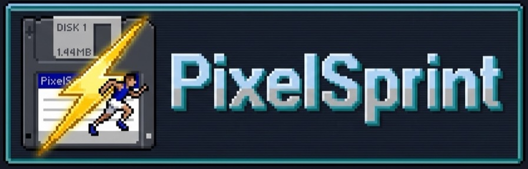
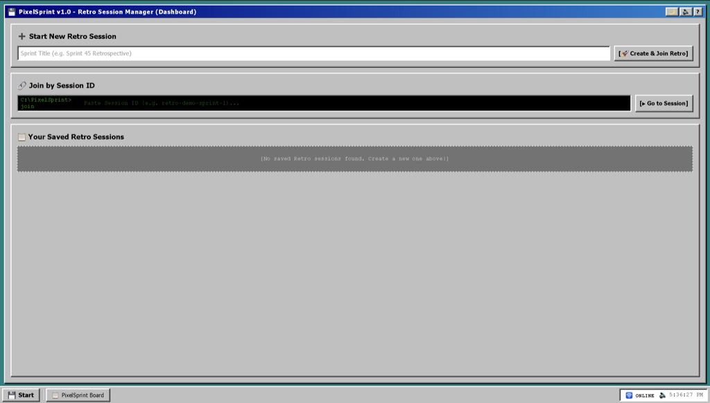
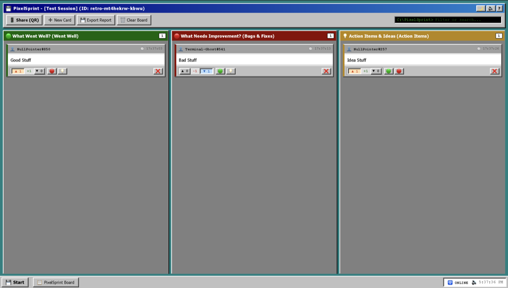
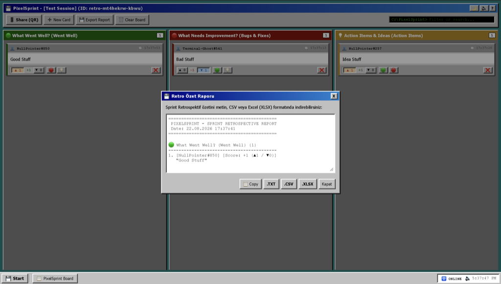
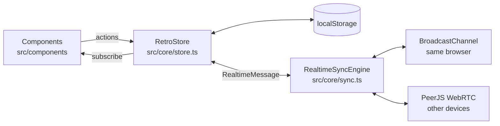

# PixelSprint

Anonymous sprint retrospective board for the browser. Windows 95 styling, installable as a PWA, synchronized across tabs and devices over WebRTC.

[](https://github.com/AtaCanYmc/PixelSprint/actions/workflows/ci.yml)
[](https://github.com/AtaCanYmc/PixelSprint/actions/workflows/deploy.yml)
[](LICENSE)

## Table of Contents

- [Overview](#overview)
- [Screenshots](#screenshots)
- [Quick Start](#quick-start)
- [Scripts](#scripts)
- [Features](#features)
- [Architecture](#architecture)
- [Project Layout](#project-layout)
- [Documentation](#documentation)
- [FAQ](#faq)
- [Contributing](#contributing)
- [License](#license)

## Overview

PixelSprint runs entirely in the browser. There is no backend and no account system. Cards, sessions, votes and timer state live in `localStorage`. Participants in the same session exchange events through `BroadcastChannel` for local tabs and PeerJS WebRTC data channels for other devices.

Each card gets a random codename such as `FloppyDisk-95#404`. Author identity is never recorded.

## Screenshots

|                Session dashboard                |                    Retro board                     |
| :---------------------------------------------: | :------------------------------------------------: |
|  |  |



## Quick Start

Requires Node.js 20 or later. CI runs on Node 20.

```bash
git clone https://github.com/AtaCanYmc/PixelSprint.git
cd PixelSprint
npm ci
npm run dev
```

Vite prints the local URL, `http://localhost:5173` by default. Open it in two tabs to see live sync.

No environment variables are required.

## Scripts

| Command               | Action                                                                                |
| :-------------------- | :------------------------------------------------------------------------------------ |
| `npm run dev`         | Start the Vite dev server with HMR.                                                   |
| `npm run build`       | Type-check with `tsc`, then emit the production bundle and service worker to `dist/`. |
| `npm run preview`     | Serve `dist/` locally to test the PWA build.                                          |
| `npm run check-types` | Run `tsc --noEmit`.                                                                   |
| `npm run format`      | Run Prettier across the repository.                                                   |

A Husky `pre-commit` hook runs `lint-staged`, which formats staged files with Prettier.

## Features

| Area         | Behavior                                                                                                                                 |
| :----------- | :--------------------------------------------------------------------------------------------------------------------------------------- |
| Columns      | Went Well, Needs Improvement, Action Items.                                                                                              |
| Voting       | One upvote or downvote per device per card.                                                                                              |
| Session host | The device that creates a session can move, delete and clear cards, mask or reveal cards, and run the timer.                             |
| Card masking | Host can hide card text from everyone during the silent writing phase.                                                                   |
| Timer        | Host sets 3, 5, 10 or 15 minutes, can pause, resume, extend by 2 or 5 minutes, or reset. When it expires, participants cannot add cards. |
| Sharing      | QR code and direct link built from `#session=<id>`.                                                                                      |
| Export       | `.txt`, `.csv` with UTF-8 BOM, `.xlsx` as SpreadsheetML, `.docx`, `.pdf` via print, clipboard copy, and email through `mailto:`.         |
| AI prompt    | Builds a prompt from the board for ChatGPT, Claude or Gemini. Nothing is sent automatically.                                             |
| UI           | Light and dark themes, emoji-only or labeled buttons, Web Audio sound effects.                                                           |
| Languages    | Turkish, English, French.                                                                                                                |
| Offline      | Workbox service worker precaches the app shell.                                                                                          |

Details are in [docs/features.md](docs/features.md).

## Architecture



See [docs/architecture.md](docs/architecture.md) and [docs/sync-protocol.md](docs/sync-protocol.md).

## Project Layout

```text
PixelSprint/
├── index.html              # App shell, modals, Start Menu markup
├── vite.config.ts          # Vite and vite-plugin-pwa config
├── public/                 # Icons and web manifest
├── docs/                   # Developer documentation
└── src/
    ├── main.ts             # Bootstraps core services and components
    ├── components/         # UI controllers: board, dashboard, modal, export, share, timer, aiPrompt, taskbar
    ├── core/               # store, sync, theme, audio, pwa
    ├── i18n/               # Translator and TR/EN/FR locale tables
    ├── types/              # Shared TypeScript interfaces
    ├── utils/              # Constants and helpers
    └── css/                # Win95, board, responsive and theme variables
```

## Documentation

| Document                                       | Content                                           |
| :--------------------------------------------- | :------------------------------------------------ |
| [docs/architecture.md](docs/architecture.md)   | Module responsibilities and data flow.            |
| [docs/sync-protocol.md](docs/sync-protocol.md) | Realtime transports and event types.              |
| [docs/features.md](docs/features.md)           | Host permissions, timer, masking, export formats. |
| [docs/i18n.md](docs/i18n.md)                   | Adding or changing translations.                  |
| [docs/storage.md](docs/storage.md)             | `localStorage` keys and data shapes.              |
| [docs/deployment.md](docs/deployment.md)       | GitHub Pages pipeline and release flow.           |

## FAQ

**Does any data leave the browser?**
Card events travel peer to peer over WebRTC. PeerJS uses its public broker at `0.peerjs.com` to exchange connection offers, so the broker sees peer IDs derived from the session ID. Card content does not pass through it.

**Is the host role secure?**
No. Host status is a list of session IDs stored in the creating browser. It prevents accidental edits, not a determined participant. See [SECURITY.md](SECURITY.md).

**Why does a new device show an empty board?**
A joining device sends `REQUEST_SYNC` and receives state from a peer that is already online. If nobody else in the session is connected, there is nothing to sync from.

**Can I use my own signaling or relay server?**
The sync engine reads an optional WebSocket URL from the `pixelsprint_ws_server_url` key in `localStorage`. There is no bundled server.

## Contributing

Read [CONTRIBUTING.md](CONTRIBUTING.md). Commits follow Conventional Commits, and releases are cut by release-please.

## License

[Apache License 2.0](LICENSE).
