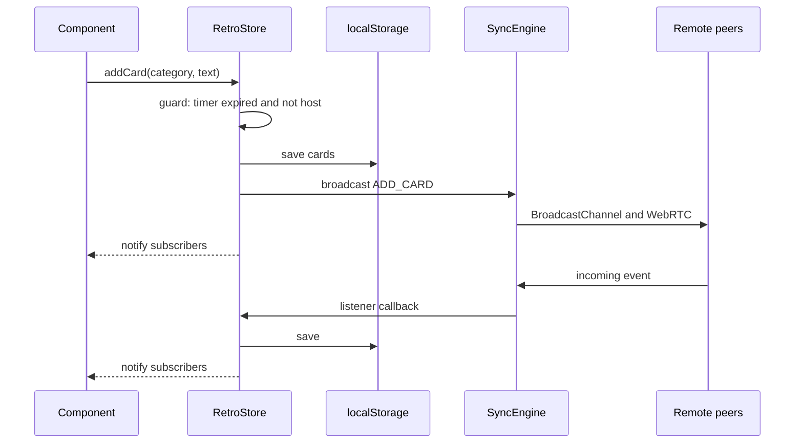

[← Back to Docs](README.md)

# Architecture

PixelSprint is a single-page TypeScript app built with Vite. It has no framework and no backend. Components manipulate DOM nodes declared in `index.html` and re-render when the store notifies them.

## Bootstrap

`src/main.ts` runs on `DOMContentLoaded` in this order:

1. `i18n.init()` loads the saved language.
2. `themeEngine.init()` applies the light or dark theme.
3. `store.init()` loads sessions, cards, host list and timer state, then opens the sync engine for the active session.
4. `pwaInstaller.init()` wires the install prompt.
5. Components are constructed and `init()` is called on each: Dashboard, Board, Modal, Export, AiPrompt, Share, Timer, Taskbar.

## Modules

| Path                          | Responsibility                                                                                                                                                        |
| :---------------------------- | :-------------------------------------------------------------------------------------------------------------------------------------------------------------------- |
| `src/core/store.ts`           | Single `RetroStore` instance. Owns sessions, cards, votes, host list, reveal state, timer state, UI preferences. Persists to `localStorage` and broadcasts mutations. |
| `src/core/sync.ts`            | `RealtimeSyncEngine`. Sends and receives `RealtimeMessage` over BroadcastChannel, PeerJS and an optional WebSocket.                                                   |
| `src/core/theme.ts`           | Light and dark theme toggle synchronized with `<meta name="color-scheme">` and `data-theme`.                                                                          |
| `src/core/audio.ts`           | Web Audio synthesizer for click, success and delete sounds.                                                                                                           |
| `src/core/pwa.ts`             | `beforeinstallprompt` handling.                                                                                                                                       |
| `src/components/board.ts`     | Renders columns, cards, votes, toolbar state.                                                                                                                         |
| `src/components/dashboard.ts` | Session list, create and join (IME-safe `Enter` handling).                                                                                                            |
| `src/components/modal.ts`     | Native `<dialog closedby="any">` modals (Add-card, About, PWA guide) opened with `.showModal()` plus light-dismiss fallback.                                          |
| `src/components/export.ts`    | Report generation for all export formats.                                                                                                                             |
| `src/components/share.ts`     | QR code and join link.                                                                                                                                                |
| `src/components/timer.ts`     | Timer modal and toolbar badge.                                                                                                                                        |
| `src/components/aiPrompt.ts`  | AI analysis prompt builder.                                                                                                                                           |
| `src/components/taskbar.ts`   | Start Menu, clock, online badge, theme and label toggles.                                                                                                             |
| `src/i18n/`                   | `i18n.t(key)` lookup and the TR, EN, FR tables.                                                                                                                       |

## State Flow

Every component subscribes with `store.subscribe()` and `i18n.subscribe()`. On any change it re-reads state and updates its DOM. There is no virtual DOM or diffing.

## Permission Checks

Host-only operations return early in the store when `isCurrentSessionHost()` is false. Components also hide or disable the related controls. Both checks run client-side. See [features.md](features.md#session-host).
