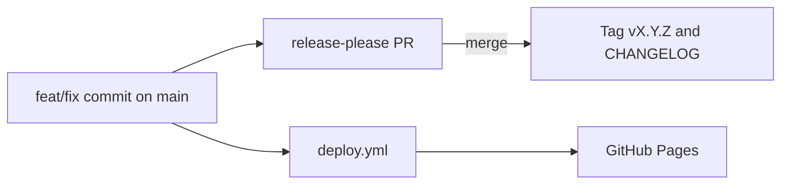

[← Back to Docs](README.md)

# Deployment and Releases

## Pipelines

| Workflow                               | Trigger                | Steps                                                                                                            |
| :------------------------------------- | :--------------------- | :--------------------------------------------------------------------------------------------------------------- |
| `.github/workflows/ci.yml`             | Pull request to `main` | `npm ci`, `npm run build`.                                                                                       |
| `.github/workflows/deploy.yml`         | Push to `main`, manual | Build, upload `dist/`, deploy to GitHub Pages.                                                                   |
| `.github/workflows/release-please.yml` | Push to `main`         | Opens or updates a release PR from Conventional Commits. Merging it tags the release and updates `CHANGELOG.md`. |
| `.github/dependabot.yml`               | Schedule               | Dependency and action update PRs.                                                                                |

## Base Path

`vite.config.ts` sets `base: './'`. Asset URLs are relative, so the same build works at a domain root or under `/PixelSprint/` on GitHub Pages.

## Self-Hosting

`dist/` is static. Serve it from any static host over HTTPS. Service workers and WebRTC require a secure context, except on `localhost`.

```bash
npm ci
npm run build
npx vite preview
```

## Release Flow


