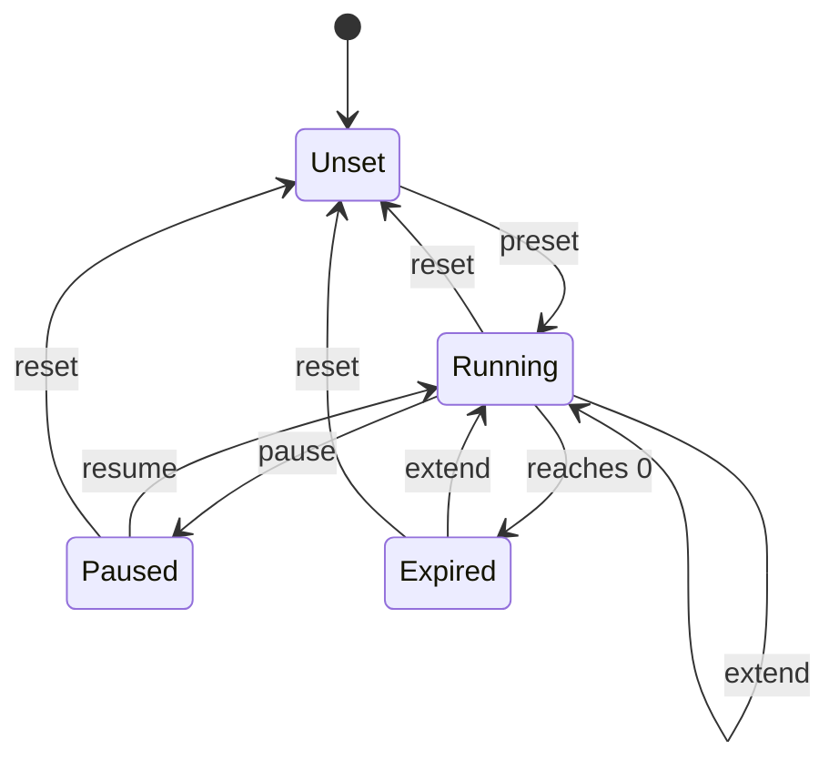

[← Back to Docs](README.md)

# Features

## Sessions

A session is identified by a slug such as `retro-demo-sprint-1`. The active session is stored in the URL hash `#session=<id>`, so the link can be bookmarked or shared. The dashboard lists sessions saved in the current browser.

## Session Host

The browser that creates a session adds its ID to `pixelsprint_hosted_sessions`. That browser is the host for the session.

| Action                            | Host |         Participant          |
| :-------------------------------- | :--: | :--------------------------: |
| Add card                          | Yes  | Yes, until the timer expires |
| Vote                              | Yes  |             Yes              |
| Move or delete card               | Yes  |              No              |
| Clear board                       | Yes  |              No              |
| Mask or reveal cards              | Yes  |              No              |
| Start, pause, extend, reset timer | Yes  |              No              |

Host status is not authenticated. Clearing site data removes it. Copying the key to another browser grants it.

## Card Masking

While cards are masked, every client renders card text as hidden. The host toggles the state and it is sent as `TOGGLE_REVEAL_CARDS`. Use it for a silent writing phase before discussion.

## Timer

| Control          | Effect                                         |
| :--------------- | :--------------------------------------------- |
| Presets          | 3, 5, 10, 15 minutes. Starts immediately.      |
| Pause and Resume | Freezes and continues the countdown.           |
| Extend           | Adds 2 or 5 minutes. Clears the expired state. |
| Reset            | Removes the timer.                             |

The host browser ticks every second and broadcasts `UPDATE_TIMER`. When the countdown reaches zero, `isExpired` becomes true and participants get an alert instead of the add-card modal. The host can still add cards and can extend the timer to reopen entry.

## Voting

Each device can cast one upvote or downvote per card. The vote is remembered locally so a reload does not allow a second vote.

## Export

| Format  | Implementation                                                                                   |
| :------ | :----------------------------------------------------------------------------------------------- |
| Copy    | Plain-text summary to the clipboard.                                                             |
| `.txt`  | Plain-text summary.                                                                              |
| `.csv`  | UTF-8 with BOM so Excel detects the encoding.                                                    |
| `.xlsx` | SpreadsheetML 2003 XML. Excel opens it directly.                                                 |
| `.docx` | Word-compatible HTML document.                                                                   |
| `.pdf`  | Opens a print view. Choose "Save as PDF" in the dialog.                                          |
| Email   | `mailto:` link with the summary in the body. Long boards may exceed the mail client's URL limit. |

## AI Prompt

The AI prompt modal builds a text prompt from current cards plus a chosen analysis type, role, language and optional focus. Buttons copy the prompt and open ChatGPT, Claude or Gemini in a new tab. The app does not call any AI API.

## Button Labels

The tag button next to the theme toggle switches between emoji-only and emoji plus text buttons. The choice is stored in `pixelsprint_show_button_labels`.
