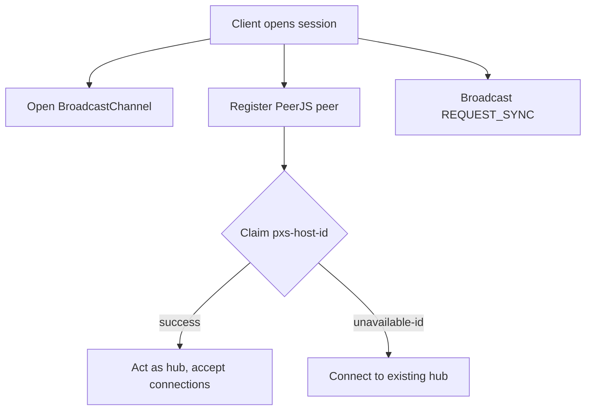

[← Back to Docs](README.md)

# Sync Protocol

`src/core/sync.ts` keeps every participant of a session in step. It opens up to three transports per session and sends the same `RealtimeMessage` over all of them.

## Transports

| Transport          | Scope                                         | Setup                                                                                                                                      |
| :----------------- | :-------------------------------------------- | :----------------------------------------------------------------------------------------------------------------------------------------- |
| `BroadcastChannel` | Tabs and windows of the same browser profile. | Channel name `pixelsprint_session_<sessionId>`.                                                                                            |
| PeerJS WebRTC      | Other devices.                                | Each client registers `pxs-<sessionId>-<clientId>`. The first client also claims `pxs-host-<sessionId>`. Others connect to that host peer. |
| WebSocket          | Optional relay.                               | Enabled only when `localStorage.pixelsprint_ws_server_url` is set.                                                                         |

Non-alphanumeric characters are stripped from the session ID before building peer IDs.



PeerJS uses the public broker at `0.peerjs.com` for signaling. Data channels are direct when NAT allows it.

## Message Shape

```ts
interface RealtimeMessage {
  type: RealtimeEventType;
  sessionId: string;
  senderId: string; // random per page load
  timestamp: number;
  payload?: any;
}
```

Messages whose `senderId` matches the local client are ignored.

## Event Catalog

| Type                  | Sender            | Payload                                      |
| :-------------------- | :---------------- | :------------------------------------------- |
| `ADD_CARD`            | Any participant   | New card.                                    |
| `UPVOTE_CARD`         | Any participant   | Card ID.                                     |
| `DOWNVOTE_CARD`       | Any participant   | Card ID.                                     |
| `MOVE_CARD`           | Host              | Card ID and target category.                 |
| `DELETE_CARD`         | Host              | Card ID.                                     |
| `CLEAR_CARDS`         | Host              | None.                                        |
| `TOGGLE_REVEAL_CARDS` | Host              | Reveal flag.                                 |
| `UPDATE_TIMER`        | Host              | `{ timerState }`                             |
| `REQUEST_SYNC`        | Joining client    | None.                                        |
| `SYNC_STATE`          | Any online client | Full card list, reveal flag and timer state. |

## Late Joiners

A device that opens a session sends `REQUEST_SYNC`. Any connected peer replies with `SYNC_STATE`. If no peer is online, the joiner starts with whatever its own `localStorage` holds for that session.
